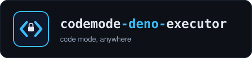
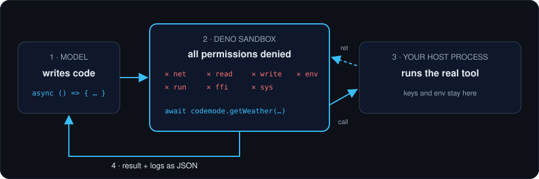
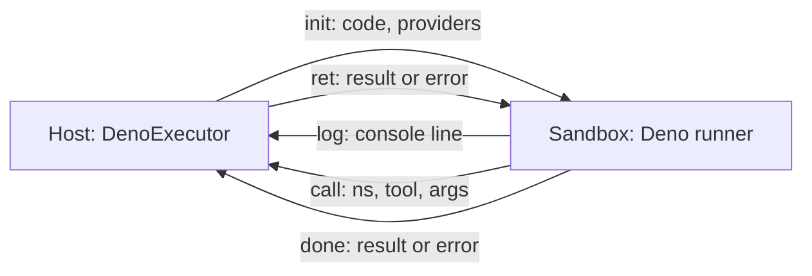

<div align="center">



### Run Cloudflare Code Mode anywhere. A locked-down Deno sandbox for LLM-generated code.

[](https://github.com/Parthkomalwad/codemode-deno-executor/actions/workflows/ci.yml)
[](LICENSE)
[](package.json)
[](https://deno.com)
[](CHANGELOG.md)
[](https://www.npmjs.com/package/@cloudflare/codemode)

[Quick start](#quick-start) · [See it work](#see-it-work) · [Why](#why) · [How it works](#how-it-works) · [Security](#security-model) · [Roadmap](#roadmap)

<br>



</div>

**Code Mode lets a model write one script that calls your tools, instead of calling them one at a time. That script needs somewhere safe to run. `@cloudflare/codemode` ships `DynamicWorkerExecutor`, which needs Cloudflare Workers. `DenoExecutor` implements the same `Executor` interface and runs the script in a Deno subprocess with every permission denied, so Code Mode works in Node servers, CLIs, local agents and CI.**

> **Alpha.** This runs code written by a model on your machine. Read [SECURITY.md](SECURITY.md) for what the sandbox does and does not protect against before you rely on it.

## Quick start

Needs Node 20+ and [Deno 2](https://deno.com) on the machine that runs the agent.

```sh
npm install codemode-deno-executor @cloudflare/codemode
```

```ts
import { createBrowserCodeTool } from "@cloudflare/codemode/browser";
import { DenoExecutor } from "codemode-deno-executor";

const codeTool = createBrowserCodeTool({
  tools: myTools,
  executor: new DenoExecutor(),
});
```

Give `codeTool.name`, `description` and `inputSchema` to your model as a tool, and call `codeTool.execute({ code })` when the model uses it. [`examples/basic.mjs`](examples/basic.mjs) is a runnable version.

> **Why `/browser`?** In `@cloudflare/codemode` 0.5.5, the main entry and `/ai` import the Workers-only `cloudflare:workers` module, so they fail to load in Node. `/browser` does not, and its `createBrowserCodeTool` accepts any executor.

You can also call the executor directly:

```ts
const { result, error, logs } = await new DenoExecutor().execute(
  `async () => (await github.listIssues({ state: "open" })).length`,
  [{ name: "github", fns: { listIssues: async (args) => myGithub.issues(args) } }],
);
```

## See it work

All four runs come from [`examples/see-it-work.mjs`](examples/see-it-work.mjs), with a `github` provider whose tools live in the host process.

**1. Several tool calls in one script.** The model's code fans out three calls in parallel and reduces the results inside the sandbox.

```text
$ node examples/see-it-work.mjs tools
{ result: { repo: 'web', open: 31 }, logs: [ 'checked 3 repos' ] }
took 48 ms
```

**2. A blocked `fetch`.** The code reads tool data, then tries to post it somewhere else. Network is denied, so it fails.

```text
$ node examples/see-it-work.mjs fetch
{
  result: undefined,
  error: 'Requires net access to "attacker.example:443", run again with the --allow-net flag',
  logs: []
}
took 56 ms
```

**3. An infinite loop, killed at the timeout.** `while (true) {}` blocks the event loop, so the host kills the process. Logs written before the loop survive.

```text
$ node examples/see-it-work.mjs loop
{
  result: undefined,
  error: 'Execution timed out',
  logs: [ 'starting' ]
}
took 2019 ms
```

**4. Out of memory.** The heap is capped (64 MB in this run), and the error says so.

```text
$ node examples/see-it-work.mjs memory
{
  result: undefined,
  error: 'Sandbox ran out of memory (limit 64 MB)',
  logs: []
}
took 240 ms
```

## Why

| | `DenoExecutor` | `DynamicWorkerExecutor` | `IframeSandboxExecutor` | Upstream README's `AsyncFunction` example |
| --- | :---: | :---: | :---: | :---: |
| Runs in a Node process | ✅ | ❌ Workers only | ❌ browser only | ✅ |
| Generated code is isolated from the host process | ✅ separate OS process | ✅ separate isolate | ✅ sandboxed iframe | ❌ runs in the host |
| Network blocked by default | ✅ | ✅ `globalOutbound: null` | ✅ CSP `default-src 'none'` | ❌ |
| No access to host files and env vars | ✅ | ✅ | ✅ | ❌ |
| Timeout stops `while (true) {}` | ✅ | not tested | ❌ documented limitation | ❌ no timeout |
| Heap limit | ✅ `memoryLimitMb` | not tested | not tested | ❌ |
| Accepts TypeScript syntax | ✅ | ❌ JavaScript only | ❌ JavaScript only | ❌ |
| Workers RPC `connectors` | ❌ | ✅ | ❌ | ❌ |

Upstream facts are from the `@cloudflare/codemode` 0.5.5 README and source.

## How it works

Each `execute()` call spawns `deno run` with every permission denied and runs [`runner/runner.js`](runner/runner.js). Host and sandbox talk newline-delimited JSON over stdin and stdout.



| Message | Direction | Fields | Meaning |
| --- | --- | --- | --- |
| `init` | host to sandbox | `code`, `providers[{name, prelude}]` | Code to run and the namespaces to create. |
| `log` | sandbox to host | `line` | One `console.*` call, with `[warn] ` or `[error] ` prefixes like upstream. |
| `call` | sandbox to host | `id`, `ns`, `tool`, `args` | Generated code called `ns.tool(...args)`. |
| `ret` | host to sandbox | `id`, `result` or `error` | The host function resolved or threw. |
| `done` | sandbox to host | `result` or `error` | Code finished. The process exits. |

Your tool functions, API keys and environment never enter the sandbox. Only JSON crosses the boundary. The host treats every line from the sandbox as untrusted: malformed lines are dropped, and tool lookups only match tools you passed in.

## Options

| Option | Default | Description |
| --- | --- | --- |
| `timeout` | `30000` | Wall-clock limit in ms. The process is killed when it is reached. |
| `memoryLimitMb` | `128` | V8 heap limit for the sandbox. |
| `allowNet` | `false` | `false` blocks all network. `["api.example.com"]` allows only those hosts. `true` allows everything. |
| `maxOutputBytes` | `10485760` | Cap on everything the sandbox sends back (logs, tool calls, result). |
| `denoPath` | `"deno"` | Path to the Deno executable. |

`executor.denoArgs` returns the exact flags the sandbox runs with, so you can audit them.

## Security model

The sandbox is Deno's permission system plus V8 isolation in a separate OS process. Every permission is denied: network, read, write, env, run, FFI and sys. The `Deno` global is removed before your code runs. `new Worker()` inherits the same denied permissions, and the timeout kills the whole process, workers included.

It is not a VM or a container. For hostile multi-tenant workloads, run the agent itself inside a container or VM with OS-level limits.

- **Your tools are the real attack surface.** Generated code can call any tool you expose, with any arguments. Validate inputs and gate destructive tools behind approval.
- **Values are JSON only.** `Uint8Array`, `Date`, `Map` and similar arrive as their JSON forms. Results that cannot be serialized, such as `BigInt`, return an error.
- **`allowNet` is all or a host list.** If you enable it, generated code can send data to those hosts.

The full threat model is in [SECURITY.md](SECURITY.md).

## Differences from `DynamicWorkerExecutor`

- `connectors` (Workers RPC bindings) are not supported. `execute()` returns an error if you pass them. Expose the same functions as providers.
- Binary values are not specially encoded yet. See the roadmap.
- Each run starts a new process, not a V8 isolate, so startup costs tens of milliseconds. See the benchmarks.
- Tool name sanitizing, provider validation, log prefixes, preludes and the never-throw contract match upstream.

## Benchmarks

[`bench/latency.mjs`](bench/latency.mjs) runs 5 warmup executions, then 50 sequential executions that each make one tool call, and times the full `execute()` call, process spawn included.

| Run | Median | p90 | Min | Max |
| --- | ---: | ---: | ---: | ---: |
| 1 | 40.1 ms | 42.6 ms | 38.0 ms | 44.5 ms |
| 2 | 40.9 ms | 42.9 ms | 38.2 ms | 43.4 ms |
| 3 | 40.6 ms | 44.0 ms | 38.5 ms | 51.0 ms |

Machine: Windows 11 (NT 10.0.26200) x64, 11th Gen Intel Core i7-1165G7 @ 2.80GHz (8 threads), Node v24.19.0, Deno 2.9.7. The first run on a freshly installed Deno measured a 279.9 ms median, so expect slower first runs on a new machine. Run `node bench/latency.mjs` for numbers on yours.

## Roadmap

| Status | Item |
| :---: | --- |
| ✅ | `Executor`-compatible Deno sandbox with timeout, heap and output limits |
| ⏳ | Binary value encoding that matches Cloudflare's codec |
| ⏳ | Optional process pool to cut startup cost |
| ⏳ | Shared contract test suite for any Code Mode executor |
| ⏳ | `IsolatedVMExecutor` run against the same suite, with benchmarks |

✅ done · 🔧 in progress · ⏳ planned

## Contributing

Issues and PRs welcome. Start with [CONTRIBUTING.md](CONTRIBUTING.md). The rules in [CLAUDE.md](CLAUDE.md) apply to people and AI sessions alike. Report vulnerabilities privately, as described in [SECURITY.md](SECURITY.md).

```sh
npm ci
npm test   # build, type-check against @cloudflare/codemode, run the test suite
```

<div align="center">

<sub>codemode-deno-executor · code mode, anywhere</sub>

[MIT](LICENSE) © 2026 Parth Komalwad

</div>
